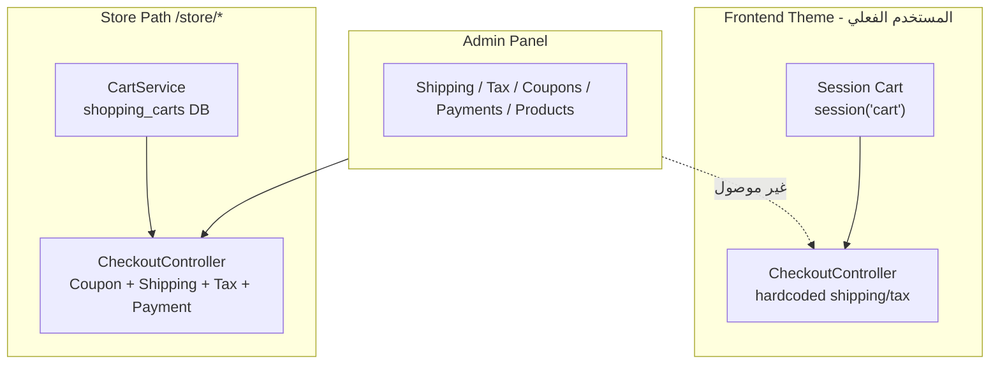

# تحليل ميزات WooCommerce ومقارنتها مع main_store

**WooCommerce Features & Gap Analysis — main_store Laravel Project**

| | |
|---|---|
| **تاريخ التحليل** | 2026-05-29 |
| **مصدر WooCommerce** | `woocommerce/` — الإصدار **10.8.1** |
| **مشروع Laravel** | `main_store` — Laravel + Blade storefront + Admin panel |
| **نطاق المقارنة** | WooCommerce **Core** فقط (لا Extensions مدفوعة) |

---

## 1. الملخص التنفيذي | Executive Summary

تم فحص مجلد WooCommerce 10.8.1 الموجود في جذر المشروع ومقارنته مع تطبيق Laravel الحالي (`main_store`).

### النتيجة الرئيسية

| المؤشر | القيمة |
|--------|--------|
| **الإنجاز الإجمالي vs WooCommerce Core** | **~48–52%** |
| **نقاط القوة** | Catalog، Admin panel، Orders management، Shipping/Tax config، Coupons admin |
| **أكبر الفجوات** | Checkout frontend، Payment gateways، REST API، Transactional emails، Coupons على المتجر |
| **مشكلة معمارية حرجة** | مساران للمتجر: Frontend (session) vs `/store/*` (DB + Services) — غير موحّدين |

### ما يعنيه ذلك عملياً

المشروع يمتلك **بنية تحتية إدارية قوية** (migrations، models، admin CRUD) لكن **مسار العميل الفعلي** (`routes/frontend.php`) لا يستخدم معظم هذه الخدمات. لذلك يبدو التقدم أعلى في لوحة التحكم وأقل في تجربة الشراء الحقيقية.

### ميزات إضافية في Laravel (خارج WC Core)

Compare، Loyalty points، Blog، WhatsApp، AI admin، Backups، Maintenance mode، Social login (Google/Facebook).

---

## 2. المنهجية | Methodology

### نطاق الفحص

- **WooCommerce Core:** `includes/`, `src/`, `templates/`, `packages/`, `assets/`
- **main_store:** `routes/`, `app/Models/`, `app/Services/`, `app/Http/Controllers/`, `database/migrations/`, `resources/views/`

### رموز الحالة | Status Legend

| الرمز | المعنى | Status |
|------|--------|--------|
| ✅ | منفّذ ويعمل على المسار الفعلي | Implemented |
| ⚠️ | جزئي / admin فقط / TODO / غير موصول | Partial |
| ❌ | غير موجود | Missing |
| 🔌 | Extension WooCommerce (خارج Core) | N/A Extension |
| ➕ | موجود في Laravel فقط | Extra in Laravel |

### مصادر WooCommerce المرجعية

| الملف | الغرض |
|-------|-------|
| `woocommerce/woocommerce.php` | Bootstrap، الإصدار 10.8.1 |
| `woocommerce/includes/class-wc-post-types.php` | Post types & taxonomies |
| `woocommerce/includes/rest-api/Server.php` | REST API wc/v1–v4 |
| `woocommerce/src/StoreApi/RoutesController.php` | Store API wc/store |
| `woocommerce/src/Internal/Features/FeaturesController.php` | Feature flags |
| `woocommerce/src/Internal/DataStores/Orders/CustomOrdersTableController.php` | HPOS |
| `woocommerce/includes/emails/` | 21+ email class |

---

## 3. ملاحظة معمارية حرجة | Critical Architecture Note



| المسار | Routes | Cart | Checkout | Views |
|--------|--------|------|----------|-------|
| **Frontend (فعّال)** | `routes/frontend.php` | Session array | مبسّط، shipping ثابت | `resources/views/frontend/` ✅ |
| **Store (بديل)** | `routes/web.php` → `/store/*` | `CartService` + DB | Services كاملة | `resources/views/store/` ❌ **غير موجود في الجذر** |

**Views Store موجودة فقط في:** `main_store/resources/views/store/` (نسخة متداخلة).

**الأثر:** Admin يُعدّ shipping zones وcoupons وtax rates، لكن `Frontend\CheckoutController` يتجاهلها:

```php
// app/Http/Controllers/Frontend/CheckoutController.php
$shippingCost = $cartTotal >= 200 ? 0 : 50;  // hardcoded
$discountAmount = session('discount', 0);      // coupon غير مفعّل
```

```php
// app/Http/Controllers/Frontend/CartController.php
// TODO: Implement coupon validation logic
```

---

## 4. جرد WooCommerce Core الكامل | Full WC Core Inventory

### 4.1 Catalog / Products | الكatalog والمنتجات

| Feature | WC Core | مرجع |
|---------|---------|------|
| Simple product | ✅ | `includes/class-wc-product-simple.php` |
| Variable product + variations | ✅ | `class-wc-product-variable.php`, `class-wc-product-variation.php` |
| Grouped product | ✅ | `class-wc-product-grouped.php` |
| External/Affiliate product | ✅ | `class-wc-product-external.php` |
| Product categories (hierarchical) | ✅ | taxonomy `product_cat` |
| Product tags | ✅ | taxonomy `product_tag` |
| Product attributes (`pa_*`) | ✅ | `woocommerce_attribute_taxonomies` |
| Product brands (merged) | ✅ | `includes/class-wc-brands.php` |
| Product images & gallery | ✅ | WP media + templates |
| Digital downloads | ✅ | `class-wc-product-download.php`, `class-wc-download-handler.php` |
| Inventory / stock management | ✅ | `includes/wc-stock-functions.php` |
| Backorder support | ✅ | product meta |
| Catalog visibility | ✅ | `src/Enums/CatalogVisibility.php` |
| Related / upsell / cross-sell | ✅ | product meta |
| Product reviews | ✅ | WP comments + REST |
| COGS (Cost of Goods) | ✅ | feature flag `cost_of_goods_sold` |
| Product CSV import | ✅ | `includes/import/class-wc-product-csv-importer.php` |
| Product CSV export | ✅ | `includes/export/class-wc-product-csv-exporter.php` |
| Product search & filters | ✅ | widgets, blocks, layered nav |
| SKU | ✅ | product meta |
| Sale price / schedule | ✅ | product meta |

### 4.2 Cart & Session | السلة والجلسة

| Feature | WC Core | مرجع |
|---------|---------|------|
| Session-based cart | ✅ | `includes/class-wc-cart-session.php` |
| Cart totals engine | ✅ | `includes/class-wc-cart-totals.php` |
| Cart fees | ✅ | `includes/class-wc-cart-fees.php` |
| Apply/remove coupons in cart | ✅ | `includes/class-wc-discounts.php` |
| Mini cart | ✅ | templates + blocks |
| Cart fragments (AJAX) | ✅ | `includes/class-wc-ajax.php` |
| Persistent cart (logged-in) | ✅ | user meta |
| Add to cart from catalog | ✅ | AJAX + forms |

### 4.3 Checkout | إتمام الشراء

| Feature | WC Core | مرجع |
|---------|---------|------|
| Billing & shipping fields | ✅ | `templates/checkout/` |
| Guest checkout | ✅ | settings |
| Shipping method selection | ✅ | zones at checkout |
| Tax calculation at checkout | ✅ | `includes/class-wc-tax.php` |
| Payment method selection | ✅ | gateways |
| Order review step | ✅ | templates |
| Thank you / order received | ✅ | `checkout/thankyou.php` |
| Pay for order (pending) | ✅ | endpoint `order-pay` |
| Checkout validation | ✅ | `includes/class-wc-validation.php` |
| Draft orders | ✅ | status `checkout-draft` |
| Rate limiting | ✅ | feature `rate_limit_checkout` |
| Block checkout | ✅ | `src/Blocks/BlockTypes/Checkout.php` |

### 4.4 Orders & HPOS | الطلبات

| Feature | WC Core | مرجع |
|---------|---------|------|
| Order lifecycle / statuses | ✅ | `src/Enums/OrderStatus.php` |
| Order items (product, shipping, tax, fee, coupon) | ✅ | `class-wc-order-item-*.php` |
| Order notes (customer + private) | ✅ | order comments |
| Refunds (full + partial, line-item) | ✅ | `class-wc-order-refund.php` |
| Manual order creation (admin) | ✅ | admin |
| HPOS (custom order tables) | ✅ | `CustomOrdersTableController.php` |
| Order fulfillments | ✅ | feature flag `fulfillments` |
| Order attribution (UTM) | ✅ | feature `order_attribution` |
| Receipt rendering | ✅ | `src/Internal/ReceiptRendering/` |
| Restock on refund | ✅ | `RestockRefundedItemsAdjuster.php` |

**Order statuses:** pending, failed, on-hold, processing, completed, cancelled, refunded, draft, checkout-draft

### 4.5 Customers & My Account | العملاء والحساب

| Feature | WC Core | مرجع |
|---------|---------|------|
| Customer registration / login | ✅ | WP users |
| My Account dashboard | ✅ | `templates/myaccount/` |
| Order history | ✅ | endpoint `orders` |
| View single order | ✅ | endpoint `view-order` |
| Downloads (digital) | ✅ | endpoint `downloads` |
| Addresses (billing/shipping) | ✅ | endpoint `edit-address` |
| Edit account details | ✅ | endpoint `edit-account` |
| Saved payment methods | ✅ | `class-wc-payment-tokens.php` |
| Lost password | ✅ | WP + WC emails |
| Order tracking (guest) | ✅ | shortcode `[woocommerce_order_tracking]` |
| GDPR export/erase | ✅ | `includes/class-wc-privacy.php` |

### 4.6 Coupons & Discounts | الكوبونات

| Feature | WC Core | مرجع |
|---------|---------|------|
| Fixed cart discount | ✅ | `includes/class-wc-coupon.php` |
| Fixed product discount | ✅ | |
| Percentage discount | ✅ | |
| Usage limits (per coupon / per user) | ✅ | |
| Expiry dates | ✅ | |
| Product/category restrictions | ✅ | |
| Minimum/maximum spend | ✅ | |
| Free shipping coupon | ✅ | |
| Exclude sale items | ✅ | |
| Usage tracking | ✅ | coupon meta |

### 4.7 Payments | المدفوعات

| Feature | WC Core | مرجع |
|---------|---------|------|
| Payment gateway abstraction | ✅ | `abstracts/abstract-wc-payment-gateway.php` |
| PayPal Standard | ✅ | `gateways/paypal/` |
| BACS (bank transfer) | ✅ | `gateways/bacs/` |
| Cheque | ✅ | `gateways/cheque/` |
| Cash on Delivery (COD) | ✅ | `gateways/cod/` |
| Payment webhooks (PayPal) | ✅ | PayPal module |
| Saved cards / tokens | ✅ | payment tokens |
| 🔌 Stripe / WooPayments | 🔌 | Extensions |

### 4.8 Shipping & Tax | الشحن والضرائب

| Feature | WC Core | مرجع |
|---------|---------|------|
| Shipping zones | ✅ | `class-wc-shipping-zones.php` |
| Zone locations | ✅ | |
| Flat rate | ✅ | `shipping/flat-rate/` |
| Free shipping | ✅ | `shipping/free-shipping/` |
| Local pickup | ✅ | `shipping/local-pickup/` |
| Shipping classes | ✅ | taxonomy `product_shipping_class` |
| Shipping calculator (cart) | ✅ | `cart/shipping-calculator.php` |
| Tax classes | ✅ | settings + REST |
| Tax rates (by location) | ✅ | |
| Prices incl/excl tax | ✅ | settings |
| Geolocation | ✅ | `class-wc-geolocation.php`, MaxMind |

### 4.9 Reviews | المراجعات

| Feature | WC Core | مرجع |
|---------|---------|------|
| Product reviews (submit) | ✅ | comments |
| Star ratings | ✅ | |
| Review moderation | ✅ | admin |
| Verified owner badge | ✅ | |
| Review request email | ✅ | feature `customer_review_request` |
| REST reviews API | ✅ | `product-reviews` controller |

### 4.10 Emails | البريد الإلكتروني

**21+ email class** في `woocommerce/includes/emails/`:

| Email | المستلم |
|-------|---------|
| New order | Admin |
| Failed order | Admin |
| Cancelled order | Admin + Customer |
| Customer processing order | Customer |
| Customer completed order | Customer |
| Customer on-hold order | Customer |
| Customer failed order | Customer |
| Customer invoice | Customer |
| Customer note | Customer |
| Customer refunded / partially refunded | Customer |
| Customer new account | Customer |
| Customer reset password | Customer |
| Customer review request | Customer |
| Fulfillment created/updated/deleted | Customer |
| POS completed/refunded | Customer |
| Admin payment gateway enabled | Admin |
| Stock notification | Customer |

**Extras:** deferred emails، block email editor، email improvements (feature flags)

### 4.11 Reports & Analytics | التقارير

| Feature | WC Core | مرجع |
|---------|---------|------|
| Legacy reports (sales, taxes, stock, customers) | ✅ | `includes/admin/reports/` |
| WooCommerce Analytics (React) | ✅ | `src/Admin/API/Reports/` |
| Revenue / orders charts | ✅ | wc-analytics |
| Product / category reports | ✅ | |
| Coupon usage reports | ✅ | |
| Stock reports (low/out) | ✅ | |
| CSV export (analytics) | ✅ | |
| Leaderboards | ✅ | |

### 4.12 REST API & Integrations | واجهات API

| Namespace | الغرض | مرجع |
|-----------|-------|------|
| `wc/v1`, `wc/v2`, `wc/v3` | Admin REST API | `includes/rest-api/Server.php` |
| `wc/v4` | Modern REST (feature flag) | `src/Internal/RestApi/Routes/V4/` |
| `wc/store/v1` | Storefront Store API | `src/StoreApi/` |
| `wc-admin` | Admin onboarding/settings | `src/Admin/API/` |
| `wc-analytics` | Analytics data | `src/Admin/API/Reports/` |
| Webhooks | Outbound events | `includes/class-wc-webhook.php` |
| REST API keys | Authentication | Advanced settings |
| OAuth (`wc-auth`) | Third-party auth | `includes/class-wc-auth.php` |

**Store API highlights:** cart CRUD، checkout، products catalog، categories، coupons apply

### 4.13 Frontend / Blocks / Templates | الواجهة

| Feature | WC Core | مرجع |
|---------|---------|------|
| PHP templates (overridable) | ✅ | `templates/` |
| 139+ Gutenberg blocks | ✅ | `src/Blocks/BlockTypes/` |
| Block cart & checkout | ✅ | feature `cart_checkout_blocks` |
| Product filter blocks | ✅ | `ProductFilter*` |
| Widgets (cart, categories, price filter…) | ✅ | `includes/widgets/` |
| Shortcodes | ✅ | `includes/class-wc-shortcodes.php` |
| Breadcrumbs | ✅ | `templates/global/breadcrumb.php` |

### 4.14 Inventory & Notifications | المخزون

| Feature | WC Core | مرجع |
|---------|---------|------|
| Stock quantity tracking | ✅ | |
| Low stock / out of stock thresholds | ✅ | |
| Back-in-stock notifications | ✅ | `src/Internal/StockNotifications/` |
| Stock reports | ✅ | |

### 4.15 Import/Export & Platform | منصة

| Feature | WC Core | مرجع |
|---------|---------|------|
| Product CSV import/export | ✅ | import/export classes |
| Action Scheduler (jobs) | ✅ | `packages/action-scheduler/` |
| WP-CLI commands | ✅ | `includes/cli/` |
| Feature flags system | ✅ | `FeaturesController.php` |
| Blueprint (settings import) | ✅ | feature `blueprint` |
| Point of Sale | ✅ | feature `point_of_sale` |
| Sample data | ✅ | `sample-data/` |

### 4.16 صراحةً خارج Core | Explicitly NOT in Core

| Feature | الحالة |
|---------|--------|
| Subscriptions | 🔌 Extension |
| Bookings | 🔌 Extension |
| Memberships | 🔌 Extension |
| Wishlist | 🔌 Extension (YITH etc.) |
| Product Bundles / Composite | 🔌 Extension |
| WooPayments / Stripe gateway | 🔌 Extension |
| Automated tax (TaxJar) | 🔌 Extension |
| Multi-vendor | 🔌 Extension |
| Loyalty points | 🔌 Extension |

---

## 5. جرد مشروع main_store | Laravel Project Inventory

### 5.1 Routes — المسارات

#### Frontend (`routes/frontend.php`) — **المستخدم الفعلي**

| Feature | Route | Controller |
|---------|-------|------------|
| Home | `GET /` | `HomeController` |
| Shop + AJAX catalog | `GET shop`, `shop/products` | `ShopController`, `ShopCatalogController` |
| Category | `GET category/{slug}` | `CategoryController` |
| Product + quick view | `GET product/{slug}` | `ProductController` |
| Currency switch | `GET currency/{code}` | `CurrencyController` |
| Cart CRUD + dropdown + coupons | `cart/*` | `CartController` |
| Checkout | `checkout/*` (auth) | `CheckoutController` |
| Blog | `blog/*` | `BlogController` |
| Static pages | about, contact, faq, privacy, terms | `PageController` |
| Track order | `track-order` | `TrackOrderController` |
| Account | `account/*` (auth) | `AccountController` |
| Wishlist | `wishlist/*` | `WishlistController` |
| Compare | `compare/*` | `CompareController` |

#### Store alternate (`routes/web.php`) — **غير مستخدم بالواجهة**

| Route | Controller |
|-------|------------|
| `POST store/cart` | `Store\CartController` |
| `POST store/checkout` | `Store\CheckoutController` |
| Downloads | `Store\DownloadController` |

#### Admin (`routes/admin.php`)

Products, categories, brands, attributes, orders, order-returns, payment-methods, reviews, coupons, shipping zones, tax, reports, customers, loyalty, inventory, wishlists, currencies, email templates/settings, blog, AI, backups, WhatsApp, site settings, activity log, system status.

#### API

❌ **لا يوجد** `routes/api.php` — لا REST API للمتجر.

### 5.2 Models | النماذج

| Model | الغرض |
|-------|-------|
| `Product`, `ProductVariant`, `ProductImage`, `ProductFile` | Catalog |
| `ProductAttribute`, `ProductAttributeValue` | Attributes |
| `Category`, `Brand` | Taxonomy |
| `ShoppingCart`, `ShoppingCartItem` | DB cart |
| `Order`, `OrderItem`, `OrderAddress`, `OrderStatus`, `OrderStatusHistory` | Orders |
| `Payment`, `PaymentMethod` | Payments |
| `Coupon`, `CouponUsage` | Coupons |
| `ShippingZone`, `ShippingZoneLocation`, `ShippingMethod`, `ShippingMethodRule` | Shipping |
| `TaxClass`, `TaxRate` | Tax |
| `Wishlist` | Wishlist |
| `OrderDownload` | Digital downloads |
| `OrderReturn`, `OrderReturnItem` | RMA |
| `StockMovement` | Inventory audit |
| `Currency` | Multi-currency |
| `Review`, `ReviewReply`, `ReviewInteraction` | Reviews |
| `CustomerAddress`, `CustomerNote` | Customer (on User) |
| `LoyaltyPointTransaction` | Loyalty |
| `EmailTemplate`, `EmailSetting` | Emails |
| `User` | Customer identity |

### 5.3 Services | الخدمات

| Service | الحالة | مستخدم في Frontend؟ |
|---------|--------|----------------------|
| `ShopCatalogService` | ✅ | ✅ |
| `CartService` | ✅ | ❌ (Store only) |
| `CouponService` | ✅ | ❌ |
| `ShippingService` | ✅ | ❌ |
| `TaxService` | ✅ | ❌ |
| `WishlistService` | ✅ | ✅ |
| `CompareService` | ✅ | ✅ |
| `CurrencyService` | ✅ | ⚠️ switch route |
| `LoyaltyService` | ✅ | ❌ checkout |
| `EmailTemplateService`, `EmailSender` | ✅ | ❌ order trigger |
| `ProductLayoutService` | ✅ | ✅ |
| `SiteSettingsService` | ✅ | ✅ |

### 5.4 Migrations الرئيسية | Key Migrations

| Area | Migration |
|------|-----------|
| Products | `2026_02_24_200001_create_products_table.php` |
| Variants | `2026_02_24_200003_create_product_variants_table.php` |
| Attributes | `2026_02_24_200002_create_product_attributes_table.php` |
| Brands | `2026_03_02_160000_create_brands_table.php` |
| Digital | `2026_03_02_170000_add_digital_fields_to_products_table.php` |
| Cart DB | `2026_02_24_200006_create_shopping_carts_table.php` |
| Orders | `2026_02_24_200007_create_orders_tables.php` |
| Payments | `2026_02_24_200008_create_payments_tables.php` |
| Coupons | `2026_02_24_200009_create_coupons_table.php` |
| Shipping | `2026_03_02_200200_create_shipping_tables.php` |
| Tax | `2026_03_02_200300_create_tax_tables.php` |
| Wishlist | `2026_03_02_220000_create_wishlists_table.php` |
| Returns | `2026_03_02_240000_create_order_returns_tables.php` |
| Loyalty | `2026_03_04_100000_*` |

---

## 6. مصفوفة المقارنة | Comparison Matrix

### 6.1 Catalog / Products

| Feature | WC | Laravel | Evidence | Priority |
|---------|----|---------|----------|----------|
| Simple products | ✅ | ✅ | `Product` model, admin CRUD | — |
| Variable products + variants | ✅ | ✅ | `ProductVariant`, frontend product page | — |
| Grouped products | ✅ | ❌ | — | Low |
| External/affiliate products | ✅ | ❌ | — | Low |
| Categories (hierarchical) | ✅ | ✅ | `Category`, `CategoryController` | — |
| Tags | ✅ | ⚠️ | Blog tags only, not product tags | Medium |
| Attributes & values | ✅ | ✅ | `ProductAttribute`, admin + product | — |
| Brands | ✅ | ✅ | `Brand` model (WC merged brands) | — |
| Product gallery | ✅ | ✅ | `ProductImage` | — |
| Digital downloads | ✅ | ⚠️ | `ProductFile`, `OrderDownload`; account UI `#` | High |
| SKU | ✅ | ✅ | products table | — |
| Sale price | ✅ | ✅ | product fields | — |
| Stock management | ✅ | ✅ | stock fields, `InventoryController` | — |
| Backorders | ✅ | ⚠️ | field exists, verify frontend | Low |
| Related/upsell/cross-sell | ✅ | ⚠️ | related products section on product page | Medium |
| Product reviews (display) | ✅ | ✅ | `Review`, product show | — |
| Product reviews (submit) | ✅ | ❌ | no frontend route | High |
| Review moderation | ✅ | ✅ | admin `ReviewController` | — |
| COGS | ✅ | ❌ | — | Low |
| CSV import/export | ✅ | ❌ | — | Medium |
| Product quick view | ➕ | ✅ | `ProductController@quickView` | — |
| Product layout switcher | ➕ | ✅ | `ProductLayoutService` | — |
| Catalog filters/sort | ✅ | ✅ | `ShopCatalogService` | — |
| Compare products | 🔌/➕ | ✅ | `CompareService` (max 4) | — |

### 6.2 Cart & Session

| Feature | WC | Laravel | Evidence | Priority |
|---------|----|---------|----------|----------|
| Session cart | ✅ | ✅ | `Frontend\CartController`, session | — |
| DB persistent cart | ✅ | ⚠️ | `CartService` — Store path only | High |
| Add/update/remove items | ✅ | ✅ | cart routes | — |
| Mini cart / dropdown | ✅ | ✅ | `cart/dropdown` AJAX | — |
| Cart totals | ✅ | ✅ | calculated in controller | — |
| Apply coupon in cart | ✅ | ❌ | `applyCoupon` TODO | **Critical** |
| Remove coupon | ✅ | ⚠️ | clears session only | High |
| Cart fees | ✅ | ❌ | — | Low |
| Shipping calculator in cart | ✅ | ❌ | — | Medium |
| Cross-sells in cart | ✅ | ⚠️ | partial in views | Low |

### 6.3 Checkout

| Feature | WC | Laravel | Evidence | Priority |
|---------|----|---------|----------|----------|
| Checkout page | ✅ | ✅ | `frontend/pages/checkout` | — |
| Guest checkout | ✅ | ❌ | `middleware('auth')` | Medium |
| Billing address | ✅ | ⚠️ | shipping only in frontend | Medium |
| Shipping address | ✅ | ✅ | checkout form | — |
| Shipping method selection | ✅ | ❌ | hardcoded 50/0 SAR | **Critical** |
| Tax at checkout | ✅ | ❌ | `TaxService` unused on frontend | **Critical** |
| Coupon at checkout | ✅ | ❌ | session discount, no validation | **Critical** |
| Payment method selection | ✅ | ⚠️ | hardcoded strings, not `PaymentMethod` | **Critical** |
| Order notes | ✅ | ✅ | `customer_note` field | — |
| Thank you page | ✅ | ⚠️ | redirect, basic | Medium |
| Pay for pending order | ✅ | ❌ | — | Medium |
| Stock decrement on order | ✅ | ✅ | checkout logic | — |
| Store path full checkout | ✅ | ⚠️ | `Store\CheckoutController` — no views | High |

### 6.4 Orders

| Feature | WC | Laravel | Evidence | Priority |
|---------|----|---------|----------|----------|
| Order creation | ✅ | ✅ | both checkout controllers | — |
| Order statuses | ✅ | ✅ | `OrderStatus`, admin update | — |
| Status history | ✅ | ✅ | `OrderStatusHistory` | — |
| Order items | ✅ | ✅ | `OrderItem` | — |
| Order addresses | ✅ | ✅ | `OrderAddress` | — |
| Admin order management | ✅ | ✅ | `admin/orders` | — |
| Customer order history | ✅ | ✅ | `AccountController` | — |
| Order tracking (guest) | ✅ | ✅ | `TrackOrderController` | — |
| Order notes (admin) | ✅ | ⚠️ | `CustomerNote` on customer, not order | Medium |
| Refunds | ✅ | ⚠️ | RMA (`OrderReturn`), not financial refund | High |
| Partial refunds | ✅ | ❌ | — | High |
| Manual order (admin) | ✅ | ❌ | — | Medium |
| HPOS-style custom tables | ✅ | ✅ | Laravel uses custom tables natively | — |
| Fulfillments | ✅ | ❌ | — | Low |
| Order attribution | ✅ | ❌ | IP/user_agent only | Low |
| Loyalty on order | ➕ | ⚠️ | admin status awards; no checkout redeem | Medium |

### 6.5 Customers & Account

| Feature | WC | Laravel | Evidence | Priority |
|---------|----|---------|----------|----------|
| Registration / login | ✅ | ✅ | Breeze auth | — |
| Social login | ➕ | ✅ | Google/Facebook OAuth | — |
| Account dashboard | ✅ | ✅ | `account/index` | — |
| Orders list/detail | ✅ | ✅ | `AccountController` | — |
| Downloads | ✅ | ⚠️ | view exists, link placeholder | High |
| Addresses (view) | ✅ | ✅ | `account/addresses` | — |
| Addresses (CRUD frontend) | ✅ | ❌ | admin only | High |
| Edit account details | ✅ | ⚠️ | tab exists, verify save | Medium |
| Saved payment methods | ✅ | ❌ | — | Medium |
| Password reset | ✅ | ✅ | auth routes | — |
| GDPR export/erase | ✅ | ❌ | — | Low |

### 6.6 Coupons

| Feature | WC | Laravel | Evidence | Priority |
|---------|----|---------|----------|----------|
| Admin CRUD | ✅ | ✅ | `admin/coupons` | — |
| Fixed / percent types | ✅ | ✅ | coupons table | — |
| Product/category restrictions | ✅ | ✅ | restrictions migration | — |
| Usage limits | ✅ | ✅ | coupon fields | — |
| Usage report | ✅ | ✅ | `coupons/usage-report` | — |
| Apply on storefront | ✅ | ❌ | TODO in CartController | **Critical** |
| Record `CouponUsage` | ✅ | ❌ | never created on checkout | **Critical** |
| Free shipping coupon | ✅ | ⚠️ | verify CouponService | Medium |

### 6.7 Payments

| Feature | WC | Laravel | Evidence | Priority |
|---------|----|---------|----------|----------|
| Payment methods admin | ✅ | ✅ | `PaymentMethodController` | — |
| COD | ✅ | ⚠️ | config + hardcoded checkout | High |
| Bank transfer (BACS) | ✅ | ⚠️ | same | High |
| PayPal gateway (live) | ✅ | ❌ | no SDK/IPN | **Critical** |
| Stripe gateway (live) | 🔌 | ❌ | — | High |
| Payment records | ✅ | ⚠️ | `Payment` model; Store creates pending | High |
| Webhooks | ✅ | ❌ | — | High |
| Saved cards | ✅ | ❌ | — | Medium |

### 6.8 Shipping & Tax

| Feature | WC | Laravel | Evidence | Priority |
|---------|----|---------|----------|----------|
| Shipping zones admin | ✅ | ✅ | `ShippingZoneController` | — |
| Zone locations | ✅ | ✅ | `ShippingZoneLocation` | — |
| Shipping methods + rules | ✅ | ✅ | `ShippingMethod`, rules | — |
| Flat rate / free shipping | ✅ | ✅ | method types in admin | — |
| Shipping at checkout (frontend) | ✅ | ❌ | hardcoded | **Critical** |
| Shipping classes | ✅ | ❌ | — | Low |
| Tax classes admin | ✅ | ✅ | `TaxController` | — |
| Tax rates admin | ✅ | ✅ | `TaxRate` | — |
| Tax at checkout (frontend) | ✅ | ❌ | `TaxService` unused | **Critical** |
| Geolocation | ✅ | ❌ | — | Low |

### 6.9 Reviews & Emails

| Feature | WC | Laravel | Evidence | Priority |
|---------|----|---------|----------|----------|
| Display reviews | ✅ | ✅ | product page | — |
| Submit review (customer) | ✅ | ❌ | — | High |
| Admin moderation | ✅ | ✅ | approve/reject/reply | — |
| Review settings | ✅ | ✅ | `ReviewSettingsController` | — |
| Transactional emails | ✅ | ❌ | no Mailable on order | **Critical** |
| Email templates admin | ✅ | ✅ | `EmailTemplateController` | — |
| Email sender service | ✅ | ⚠️ | `EmailSender` exists, not wired | High |
| Review request email | ✅ | ❌ | — | Medium |
| Stock notification email | ✅ | ❌ | — | Low |

### 6.10 Reports, API, Platform

| Feature | WC | Laravel | Evidence | Priority |
|---------|----|---------|----------|----------|
| Sales dashboard | ✅ | ⚠️ | `ReportController` basic | Medium |
| Analytics charts | ✅ | ❌ | — | Medium |
| Stock reports | ✅ | ⚠️ | inventory admin | Medium |
| REST Admin API | ✅ | ❌ | no api.php | High |
| Store API (headless) | ✅ | ❌ | — | High |
| Webhooks outbound | ✅ | ❌ | — | High |
| API keys / OAuth | ✅ | ❌ | — | Medium |
| Background jobs (orders) | ✅ | ❌ | no order jobs | Medium |
| Product CSV import | ✅ | ❌ | — | Medium |
| Feature flags | ✅ | ❌ | — | Low |
| Multi-currency | ✅ | ⚠️ | `Currency` + switch route | Medium |
| Wishlist | 🔌 | ✅ | `WishlistService` | — |
| Blog | ➕ | ✅ | full blog module | — |
| WhatsApp integration | ➕ | ✅ | jobs, webhooks | — |
| Backups / AI admin | ➕ | ✅ | non-WC | — |

---

## 7. نسب الإنجاز | Completion Percentages

### 7.1 حسب المجال | By Domain

| المجال / Domain | Admin | Frontend | Overall | ملاحظات |
|-----------------|-------|----------|---------|---------|
| Catalog | 85% | 80% | **82%** | قوي؛ ينقص grouped/external، CSV |
| Cart | 70% | 55% | **50%** | coupon معطّل |
| Checkout | 75% | 35% | **40%** | أكبر فجوة |
| Orders | 80% | 60% | **70%** | RMA ≠ refunds |
| Payments | 30% | 10% | **15%** | config فقط |
| Shipping & Tax | 85% | 15% | **35%** | admin كامل، frontend لا يستخدم |
| Coupons | 90% | 20% | **40%** | admin جاهز |
| Customers / Account | 75% | 50% | **55%** | addresses read-only |
| Reviews | 80% | 30% | **45%** | no submit |
| Emails | 40% | 5% | **20%** | templates بدون إرسال |
| Reports / Analytics | 45% | N/A | **40%** | basic dashboard |
| API / Webhooks | 0% | 0% | **0%** | غير موجود |
| Import / Export | 10% | N/A | **10%** | — |
| Inventory | 75% | 40% | **55%** | admin adjust + stock on order |
| Digital Downloads | 70% | 25% | **45%** | backend yes, UI no |

### 7.2 الإنجاز الإجمالي | Overall

```
الإنجاز التقديري vs WooCommerce Core:  ~48–52%
```

**توزيع الوزن:**
- Catalog + Admin infrastructure: ~35% من WC value → **~80% done**
- Customer purchase path (cart → checkout → payment → email): ~40% → **~30% done**
- API + integrations + platform: ~25% → **~15% done**

### 7.3 ما هو «جاهز لكن غير موصول» | Ready but Unwired

هذه الميزات **موجودة في الكود** لكن **لا تصل للعميل**:

1. `CouponService` → `Frontend\CartController` (TODO)
2. `ShippingService` → `Frontend\CheckoutController`
3. `TaxService` → `Frontend\CheckoutController`
4. `PaymentMethod` model → checkout UI
5. `OrderDownload` + `DownloadController` → account downloads tab
6. `LoyaltyService::redeemPoints` → checkout
7. `EmailSender` → order placed event
8. `Store\CheckoutController` full flow → needs views or merge into frontend

**إذا وُصلت هذه فقط، الإنجاز Frontend يرتفع من ~40% إلى ~65%** دون migrations جديدة.

---

## 8. خطة الأولويات | Phased Roadmap

### Phase 1 — توحيد المسار الحرج (Critical Path Unification)

**الهدف:** مسار شراء واحد يستخدم Services الموجودة.

| # | Task | Files |
|---|------|-------|
| 1 | إصلاح `applyCoupon` عبر `CouponService` | `Frontend/CartController.php` |
| 2 | ربط checkout بـ `ShippingService` + zone/method picker | `Frontend/CheckoutController.php`, checkout views |
| 3 | ربط checkout بـ `TaxService` | same |
| 4 | تسجيل `CouponUsage` عند إتمام الطلب | `CheckoutController`, `CouponUsage` |
| 5 | تحميل `PaymentMethod` من DB في checkout | checkout views, controller |
| 6 | إرسال email عند الطلب (Mailable + queue) | new Mailable, `EmailSender` |
| 7 | قرار: دمج `/store/*` في frontend أو حذفه | `routes/web.php`, controllers |

**مخرجات:** coupon + shipping + tax + payment methods + email تعمل end-to-end.

### Phase 2 — تجربة العميل الكاملة (Customer Experience)

| # | Task |
|---|------|
| 1 | Guest checkout (optional setting) |
| 2 | Address CRUD في account (POST/PUT/DELETE routes) |
| 3 | Digital downloads — ربط `DownloadController` بـ account UI |
| 4 | Customer review submit + moderation queue |
| 5 | Loyalty points redemption في checkout |
| 6 | Thank you page محسّنة + order summary email |

### Phase 3 — Payments & Operations

| # | Task |
|---|------|
| 1 | PayPal Standard integration + IPN/webhooks |
| 2 | Stripe integration (optional) |
| 3 | Financial refunds من admin (ليس RMA فقط) |
| 4 | Order notes (customer-visible + admin private) |
| 5 | Low stock / back-in-stock notifications |
| 6 | Pay for pending order flow |

### Phase 4 — API & Scale

| # | Task |
|---|------|
| 1 | `routes/api.php` — products, cart, orders (Sanctum) |
| 2 | Outbound webhooks للطلبات |
| 3 | Product CSV import/export |
| 4 | Analytics dashboard محسّن |
| 5 | Background jobs للـ emails والتقارير |

### Phase 5 — اختياري (WC Extensions Parity)

Subscriptions، Bookings، Bundles، Advanced multi-vendor — **خارج نطاق WC Core**؛ تقييم منفصل إذا مطلوب.

---

## 9. توصيات معمارية | Architecture Recommendations

### 9.1 مصدر واحد للحقيقة (Single Source of Truth)

**الخيار الموصى به:** الإبقاء على **session cart** للسرعة + استدعاء **Services** للحسابات (coupon, shipping, tax) دون مسار `/store` منفصل.

```
Frontend Cart (session) 
    → CouponService.validate()
    → ShippingService.calculate()
    → TaxService.calculate()
    → CheckoutController.store()
    → Order + CouponUsage + Payment + Email
```

### 9.2 إيقاف المسار المزدوج

- **إما** نقل views من `main_store/resources/views/store/` إلى `resources/views/store/` وتوحيد frontend على Store controllers
- **أو** (أفضل) حذف `/store/*` تدريجياً بعد نقل logic إلى Frontend controllers

### 9.3 Feature Flags بسيطة

إنشاء `config/store.php` أو استخدام `SystemSetting` لـ:

- `guest_checkout_enabled`
- `loyalty_redemption_enabled`
- `reviews_require_approval`
- `digital_downloads_enabled`

(مشابه لـ WC `FeaturesController`)

### 9.4 Events & Notifications

```php
// مقترح
OrderPlaced::class → SendOrderConfirmationEmail
OrderStatusChanged::class → SendStatusEmail + LoyaltyService::awardPoints
```

---

## 10. ملحق: مراجع الملفات | File Reference Appendix

### WooCommerce (read-only reference)

| Path | Description |
|------|-------------|
| `woocommerce/woocommerce.php` | Plugin entry, v10.8.1 |
| `woocommerce/includes/class-woocommerce.php` | Core singleton |
| `woocommerce/includes/class-wc-cart.php` | Cart |
| `woocommerce/includes/class-wc-checkout.php` | Checkout |
| `woocommerce/includes/class-wc-order.php` | Order |
| `woocommerce/includes/class-wc-coupon.php` | Coupon |
| `woocommerce/includes/class-wc-tax.php` | Tax |
| `woocommerce/includes/class-wc-shipping.php` | Shipping |
| `woocommerce/includes/gateways/` | Payment gateways |
| `woocommerce/includes/emails/` | Email classes |
| `woocommerce/includes/rest-api/Server.php` | REST API |
| `woocommerce/src/StoreApi/` | Store API |
| `woocommerce/src/Admin/` | Analytics admin |
| `woocommerce/templates/` | Storefront templates |

### main_store Laravel

| Path | Description |
|------|-------------|
| `routes/frontend.php` | Active storefront routes |
| `routes/admin.php` | Admin panel |
| `routes/web.php` | Store alternate + auth |
| `app/Http/Controllers/Frontend/` | Customer-facing controllers |
| `app/Http/Controllers/Store/` | Alternate store logic |
| `app/Http/Controllers/Admin/` | Admin controllers |
| `app/Services/CouponService.php` | Coupon validation |
| `app/Services/ShippingService.php` | Shipping calculation |
| `app/Services/TaxService.php` | Tax calculation |
| `app/Services/CartService.php` | DB cart |
| `app/Services/LoyaltyService.php` | Loyalty points |
| `app/Services/EmailSender.php` | Email dispatch |
| `database/migrations/2026_02_24_*` | Core store schema |
| `resources/views/frontend/` | Active theme views |

---

## 11. خلاصة سريعة للتنفيذ | Quick Action Checklist

| Priority | Action | Impact |
|----------|--------|--------|
| 🔴 P0 | Wire `CouponService` to cart | Coupons work |
| 🔴 P0 | Wire `ShippingService` + `TaxService` to checkout | Real totals |
| 🔴 P0 | Use `PaymentMethod` in checkout | Admin config used |
| 🔴 P0 | Send order confirmation email | Customer trust |
| 🟠 P1 | Fix downloads in account | Digital products |
| 🟠 P1 | Customer review submit | Social proof |
| 🟠 P1 | Address CRUD on frontend | Account completeness |
| 🟡 P2 | PayPal/Stripe live | Revenue |
| 🟡 P2 | REST API | Headless/mobile |
| 🟢 P3 | CSV import, analytics, fulfillments | Operations scale |

---

*هذا المستند للتوثيق والتخطيط فقط — لا يعدّل مجلد `woocommerce/`.*  
*Document generated from codebase analysis. WooCommerce folder is reference-only.*
